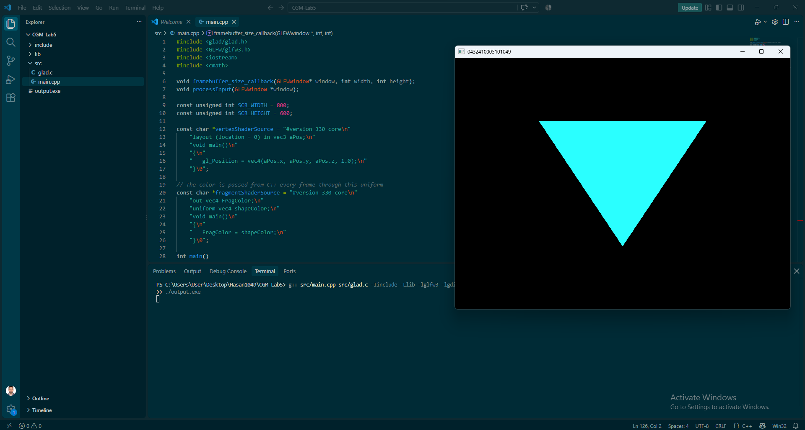
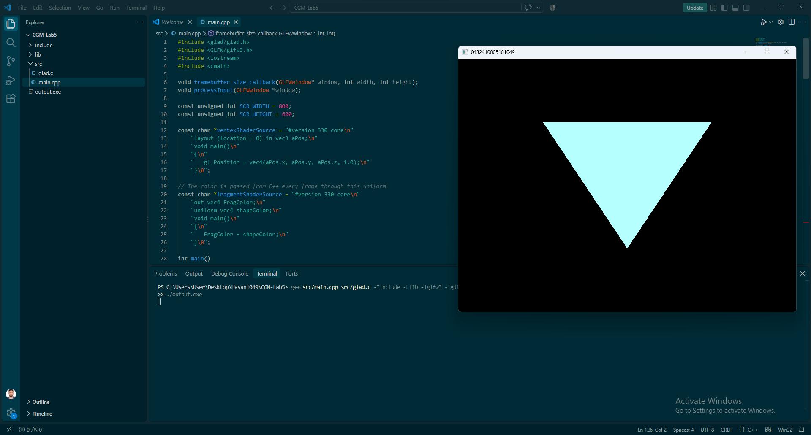

# CGM Lab Assignment 5

**Course:** CSE 0611328 – Computer Graphics and Multimedia Lab (Autumn 26)
**Name:** Md Hasan Mazumder
**Student ID:** 0432410005101049
**Section:** 6A2

## Description
This program draws an upside-down triangle at the center of a black window using GLFW/GLAD.
The triangle's color transitions smoothly from cyan to white and back again over time.
The window title is the student ID "0432410005101049". Pressing the 'M' key closes the window.

## Implementation Notes
- The triangle has its tip pointing downward: two vertices on top, one at the bottom.
- The fragment shader reads its color from a `uniform` variable (`shapeColor`).
- Every frame, a value `t = sin(time) * 0.5 + 0.5` (between 0 and 1) is computed using `glfwGetTime()`.
- The color is set to `(t, 1.0, 1.0)`: cyan when `t = 0` and white when `t = 1`.

## Tools Used
- GLFW 3.x
- GLAD (OpenGL 3.3 Core)
- MinGW-w64 (g++)

## How to Compile & Run
g++ main.cpp glad.c -I../../include -L../../lib -lglfw3 -lgdi32 -lopengl32 -o output.exe
./output.exe

## Output

### Cyan phase

### Near-white phase

